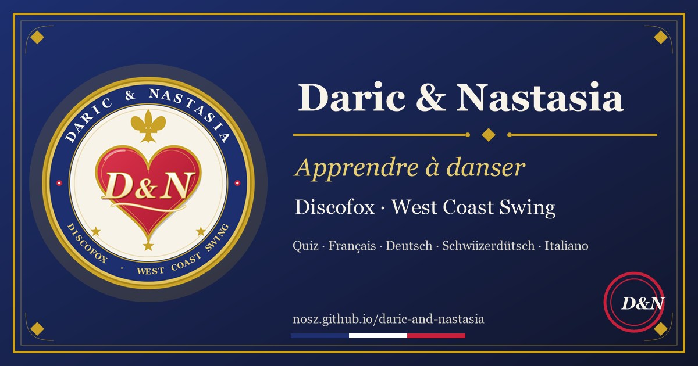

# Daric & Nastasia : apprendre à danser

**Un quiz pour apprendre le discofox et le west coast swing, avec les deux figurines pixel Daric et Nastasia, qui passent de temps en temps, donnent des conseils et te font rire.**

## [Jouer maintenant : nosz.github.io/daric-and-nastasia](https://nosz.github.io/daric-and-nastasia/)

Gratuit, sans inscription, directement dans le navigateur (téléphone, tablette, ordinateur). Ta progression et ton prénom restent uniquement sur ton appareil.

## Ce qui t'attend
- **8 petites leçons de danse** avec cartes, humour et quiz : qui sont Daric et Nastasia, la connexion (guider et suivre), le discofox (pas de base et figures), le west coast swing (slot, musique et jeu), le concours et le jugement, et un tour final autour du festival et de la scène.
- **Daric et Nastasia** traversent l'écran : d'abord avec un baiser, puis avec des conseils, des dialogues, des courses-poursuites, des danses et, parfois, la visite de Manfred et Nela. Ils parlent toujours dans la langue choisie en haut.
- **Des diplômes** pour chaque leçon et un grand diplôme pour les huit, à enregistrer, imprimer et partager.
- **Mode clair et sombre**, choix de la langue (français, allemand, suisse allemand, italien) et un bouton pour masquer les figurines.
- **Installer et utiliser hors ligne :** sur le téléphone, via le menu du navigateur « Ajouter à l'écran d'accueil » ; sur ordinateur, « Installer l'application ».

## Langues avec lien direct
Un clic lance l'application directement dans la langue voulue (adresse avec `?lang=<code>`). Le français est la langue par défaut.

| Langue | Lien direct |
|---|---|
| 🇫🇷 Français | [https://nosz.github.io/daric-and-nastasia/?lang=fr](https://nosz.github.io/daric-and-nastasia/?lang=fr) |
| 🇩🇪 Deutsch | [https://nosz.github.io/daric-and-nastasia/?lang=de](https://nosz.github.io/daric-and-nastasia/?lang=de) |
| 🇨🇭 Schweizerdeutsch | [https://nosz.github.io/daric-and-nastasia/?lang=ch](https://nosz.github.io/daric-and-nastasia/?lang=ch) |
| 🇮🇹 Italiano | [https://nosz.github.io/daric-and-nastasia/?lang=it](https://nosz.github.io/daric-and-nastasia/?lang=it) |

## Bon à savoir
- Les faits sur Daric et Nastasia proviennent de profils publics (état au 22.10.2026) ; les titres et les années varient parfois d'une page à l'autre et ne figurent dans le quiz que lorsqu'une page les indique clairement. Les dialogues et les phrases des figurines sont inventés. Manfred et Nela sont des invités de l'application [Dance Chance](https://dance-chance.de/), l'école de danse en ligne.
- Les textes français, allemands, suisses allemands et italiens sont écrits avec affection ; les locuteurs natifs sont les bienvenus pour corriger.
- Plus d'informations sur le couple et leurs cours : [Tanzschule Joy](https://tanzschule-joy.ch/de/nastia+&+daric).

**[Created by Norbert](https://nosz.github.io/norbert-szpak/)** · Version 1.0.0 (22.10.2026)

---

# Daric & Nastasia: Tanzen lernen (Deutsch)

**Ein Quiz-Lernspiel zu Discofox und West Coast Swing, begleitet von den zwei Pixel-Figuren Daric und Nastasia, die ab und zu vorbeischauen, Tipps geben und dich zum Lachen bringen.**

## [Jetzt starten: nosz.github.io/daric-and-nastasia](https://nosz.github.io/daric-and-nastasia/?lang=de)

Kostenlos, ohne Anmeldung, läuft im Browser auf Handy, Tablet und Computer. Dein Fortschritt und dein Name bleiben nur auf deinem Gerät.

## Was dich erwartet
- **8 kurze Tanzstunden** mit Karten, Humor und einem Quiz: wer Daric und Nastasia sind, Verbindung (führen und folgen), Discofox (Grundschritt und Figuren), West Coast Swing (Slot, Musik und Spiel), Turnier und Wertung und eine Bossrunde rund um Festival und Bühne.
- **Daric und Nastasia** laufen durchs Bild: zuerst mit einem Kuss, später mit Tipps, Gesprächen, Verfolgungsjagden, Tanzeinlagen und manchmal Besuch von Manfred und Nela. Sie sprechen immer in der Sprache, die oben eingestellt ist (Französisch, Deutsch, Schweizerdeutsch oder Italienisch).
- **Diplome** für jede Tanzstunde und ein großes Diplom für alle acht, zum Speichern, Drucken und Teilen.
- **Hell und dunkel**, mit Sprachwahl und einem Knopf, mit dem du die Figuren ausblenden kannst.
- **Installieren und offline nutzen:** auf dem Handy im Browsermenü „Zum Startbildschirm hinzufügen“, am Computer „App installieren“.

## Gut zu wissen
- Die Fakten über Daric und Nastasia stammen laut öffentlicher Profile (Stand 22.10.2026); einzelne Titel- und Jahresangaben weichen auf den Seiten teils voneinander ab und stehen im Quiz nur, wo eine Seite sie ausdrücklich nennt. Die Dialoge und Sprüche der Figuren sind erfunden. Manfred und Nela sind Gäste aus der App [Dance Chance](https://dance-chance.de/), der Online-Tanzschule.
- Die französischen, deutschen, schweizerdeutschen und italienischen Texte sowie das gebrochene Deutsch von Daric und Nastasia sind liebevoll gemeint; Muttersprachler dürfen gern korrigieren.
- Mehr über das Paar und ihre Kurse: [Tanzschule Joy](https://tanzschule-joy.ch/de/nastia+&+daric).

**[Created by Norbert](https://nosz.github.io/norbert-szpak/)** · Version 1.0.0 (22.10.2026)
